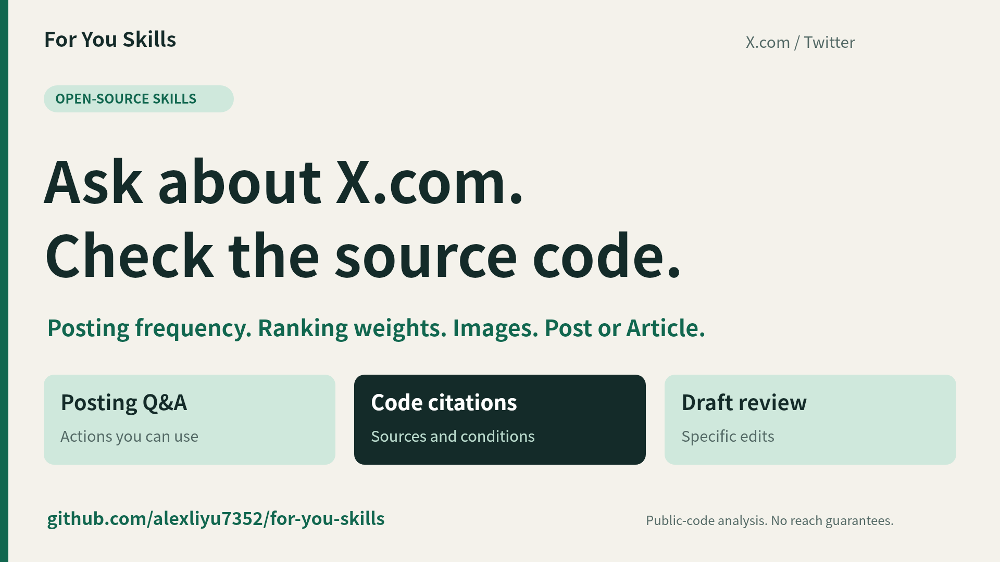

# For You Skills — X.com / Twitter Algorithm Skills

**English** | [简体中文](README.zh-CN.md)

**“I posted this morning. I have a second post ready. Should I wait until tomorrow?”**

You can ask **For You Skills** questions like this before you have a draft. Ask about posting frequency, ranking weights, links, images, or whether to publish a long Post or an Article on X.com / Twitter. It looks up the research, links to the relevant lines of public recommendation code, and explains what you can decide from them. Bring a draft or post analytics and it can also suggest edits or help investigate a change in reach.

**8 skills · 578 knowledge entries · 396 original source URLs · 49 unresolved questions preserved**

[Read the full research](https://blog.go5.si/posts/x-algorithm-teardown/) · [Follow the author for updates](https://x.com/alexlee20122022)

Install the entry skill and ask in your own words. It includes all seven workflows.

```bash
npx skills add alexliyu7352/for-you-skills --skill x-assistant
```

> I posted on X.com this morning and have a different topic ready for this afternoon. Should I publish it today? Give me a practical recommendation, check the relevant recommendation code, and explain what remains uncertain.

**Recommendation:** If the new post is ready, useful to your readers and timely, publish it today. That is an editorial recommendation; the code does not establish an ideal posting time.

**What the code establishes:** `author_pool_counts` sorts the posts being considered for a reader by score, then counts each author's posts from zero. The count starts afresh on every call. With author diversity enabled and the published VM Ranker defaults, the multiplier is `0.75 × 0.5^k + 0.25`, where `k` is that count: `1` for your highest-scoring candidate, `0.625` for your second and `0.4375` for your third. Your afternoon post could rank first. **The second-ranked candidate in this calculation is not necessarily your second post of the day.** [Counting and multiplier code](https://github.com/xai-org/x-algorithm/blob/5ed796374ea48ee26058aab66ab10c266bea2bef/xai-value-model/scoring.rs#L183-L237) · [Default settings](https://github.com/xai-org/x-algorithm/blob/5ed796374ea48ee26058aab66ab10c266bea2bef/vm-ranker/params.rs#L169-L197)

**What remains uncertain:** `0.625` is a score multiplier, not a prediction that a post keeps 62.5% of its impressions. This function supplies no daily quota or four-hour reset. It also does not establish which candidates or settings a live request uses, or your account's best posting interval. A different topic can give readers something new; it does not bypass a count based on author ID. These conclusions refer to public snapshot `5ed7963`, not verified current production settings. [Complete original answer and worked example (Chinese)](docs/demo/run-record.zh-CN.md#原始运营问答输出)

Installation checked for **Claude Code, Codex, Gemini CLI, Cursor, GitHub Copilot and OpenCode**. The assistant answers in your language. [Installation options](#installation) · [Validation report](docs/validation/results.md)

## Read the installation and Q&A evidence

[Inspect the recorded execution evidence](docs/demo/live/README.md): a fresh project installation, knowledge lookup, original code retrieval and a newly generated answer from **ChatGPT Work**. The installation log and source checks remain available; the separate recording is no longer stored in Git. [Full answer and sources (Chinese)](docs/demo/live/answer.zh-CN.md). The installation’s 31 files were checked against the repository with no differences.

## Watch two real questions in 78 seconds

At **0:15**, see how the code counts posts by the same author. At **0:47**, the author brings a different problem. They report that one Article passed 3,000 impressions in a week while their other Posts topped out in the hundreds. The review turns that observation into an introductory Post and explains which measurements would help investigate the difference.

[](https://youtu.be/QSL0kNQvs_E?si=VXDbXhogFb7bq7ip)

[Watch in English on YouTube](https://youtu.be/QSL0kNQvs_E?si=VXDbXhogFb7bq7ip) · [中文版 / Chinese on YouTube](https://youtu.be/TQfDplGaFXY?si=mNGTutX1lj7Py08r) · [English transcript](docs/demo/README.md#english-transcript) · [Original prompts, answers and source links (Chinese)](docs/demo/run-record.zh-CN.md)

Both language versions are silent, edited replays of the same two runs. The English version translates and re-typesets the original results. Videos are hosted on YouTube; the [demo files](docs/demo/README.md#demo-files) retain English and Chinese subtitles, static covers, launch copy and the original evidence. [Media hosting and history cleanup](docs/demo/media-hosting.md).

## An Article question becomes a draft you can use

The second run starts with the author's observation: **“My Article has been up for a week and still gets new impressions every day—over 3K in total. My other Posts have hundreds at most. Why?”** The request was to turn this question into an introductory Post for creators choosing between a long Post and an Article.

The review kept the observation and delivered a complete Chinese draft. Its revised opening, translated here:

> One of my Articles has been up for a week and still gets new impressions every day, with more than 3K (3,000) in total; my other Posts have hundreds at most. Why? Should I switch my long posts to Articles?

| Part of the review | What this run delivered |
| --- | --- |
| Complete copy and length | A 546-Unicode-code-point Chinese draft, including its link and paragraph breaks, after trimming surrounding whitespace. This is a text measurement, not X's weighted character count or a confirmation of publishing eligibility. |
| Format | One longer introductory Post for this material. Use an Article when the material needs multiple sections, figures and later reference; that is an editorial decision. |
| First image | A proposed comparison card: “Post: one question, a few paragraphs” / “Article: multiple sections, figures, later reference,” with the observation and its limits in the footer. The run supplied an image plan. |
| Evidence and next step | Preserve the reported numbers; check metric definitions, publication and measurement times, topics and promotion. Compare the same first seven days and record an Article separately from a Post linking to it. The observation alone does not establish that the format caused the difference. |

[Read the complete Chinese draft and review](docs/demo/run-record.zh-CN.md#完整审稿输出) · [Inspect the topic-by-topic evidence record](docs/demo/review-ledger.json). The code citations and missing evidence are retained with the original output; the English opening above is a translation, not a separately measured or reviewed draft.

## What changes when you check the code?

| Question | What the analysis found | What to do with it |
| --- | --- | --- |
| **“Which image should go first?”** | One V8.2 media-selection path returns the **first available image**. A result left only in image four is absent from that selection. [Code](https://github.com/xai-org/x-algorithm/blob/5ed796374ea48ee26058aab66ab10c266bea2bef/grox/flows/mm_emb/renderer_v82.py#L285-L314) | Put the most useful supported result and its key conditions in the first image; state the main finding in the text too. This is evidence about that processing path, not a promise of higher reach. |
| **“Must a long Post stay under 4,000 characters?”** | A specific V8.2 text-rendering path truncates body text at **4,000 characters**. That establishes a processing boundary, not a universal publishing limit. [Code](https://github.com/xai-org/x-algorithm/blob/5ed796374ea48ee26058aab66ab10c266bea2bef/grox/flows/mm_emb/renderer_v82.py#L33-L50) | Measure the draft and check where the central finding lands. Keep the full argument when it earns its length; explain the scope of the boundary before choosing a format. |

The skills carry the conditions alongside each finding. They distinguish source-code facts, official documentation, local observations, writing judgments and unresolved questions. **You can inspect why an answer was given.**

## Bring a draft. Leave with changes you can use.

A prepublication review works through every applicable topic in the research. It should give you:

- **An opening you can publish.** It quotes your actual first lines, checks the promise they make, and supplies a concrete revision when needed.
- **A measured length review.** It counts the supplied text, states the unit and checks where the important material falls.
- **An image plan for this draft.** It explains whether images would help, what the first one should convey, and what each additional image contributes. Missing attachments still receive a concrete recommendation.
- **A format decision with reasons.** It weighs a long Post, Article or Thread against the material and your goal.
- **The remaining publishing checks.** Links, reading payoff, video conditions, hashtags, visibility labels, duplication, interaction and corrections are reviewed where relevant, with evidence and explicit gaps.
- **A reader pass with a clear result.** Where a fresh context is available, a reader who did not write the draft receives the complete review standard and reports unclear references, unexplained terms and missing reasoning steps. Otherwise, the review is labeled self-review. Revisions have a default budget of three reader passes; missing facts or unresolved problems are reported explicitly. Plan-only requests continue without inventing copy, and excerpts receive only a scoped verdict. This stage is editorial judgment, reported separately from the algorithm evidence.

Already published? Supply post links, account links, screenshots or exports. The review workflow can use an authorized browser or Chrome MCP when available, record what it actually sees, and suggest specific changes. Reach diagnosis separates observations from possible explanations and tells you what evidence would distinguish them.

## Turn the image plan into images

Ask **“Create the images from this review, and keep this series visually consistent.”** The assistant carries the draft, sources and image order into `x-create-visuals`; you do not need to explain the material again.

It checks the tools actually available, tells you when it can generate images directly, and offers your own assets, real screenshots, AI generation or a mixture. The first time, it asks for the missing source/provider and style choices. Later, you can reuse the saved style, change it just for this post, or save a new series style. **A one-time change leaves your default untouched.**

Preferences live in a private user configuration file, outside the installed skills and public repository. Default, account and series profiles support JSON export/import between agents and devices. A new installation on the same OS account reads the same file; separate hosts need an explicit transfer. When durable storage is unavailable, the assistant says so and offers an export.

Real evidence stays real: screenshots and code panels use source material, exact charts use verified data, and AI illustration is used where appropriate. The assistant checks text, numbers, cropping and image order before delivery. If no creation tool is available, it supplies clearly labeled briefs and prompts. Image generation depends on your host and chosen provider; the package supplies no provider credentials and promises no exposure bonus.

## One entry point, seven specialists

Ask naturally. **`x-assistant` selects the workflow**, carries context into follow-up questions and combines the findings into one answer. You can also install or invoke a specialist on its own.

| Skill | Use it for |
| --- | --- |
| [`x-assistant`](skills/x-assistant/SKILL.md) | The default entry: questions, mixed requests and follow-ups |
| [`x-explain`](skills/x-explain/SKILL.md) | X.com / Twitter algorithm, ranking weights, posting frequency, reading signals, media and links |
| [`x-myth-check`](skills/x-myth-check/SKILL.md) | Check an algorithm tip or guide claim by claim, with original sources |
| [`x-format-advisor`](skills/x-format-advisor/SKILL.md) | Choose a long Post, Article or Thread for your material |
| [`x-publish-checklist`](skills/x-publish-checklist/SKILL.md) | Review an unpublished draft and provide concrete edits |
| [`x-review-posts`](skills/x-review-posts/SKILL.md) | Inspect published content or screenshots and suggest improvements |
| [`x-reach-diagnosis`](skills/x-reach-diagnosis/SKILL.md) | Investigate reach patterns and identify the next useful check |
| [`x-create-visuals`](skills/x-create-visuals/SKILL.md) | Create useful images and save, reuse or transfer your visual style |

Try these:

> My Article has 3K views after a week and still gains views daily. My other Posts have hundreds. What can we conclude, and what should I publish next?

> Check this X.com / Twitter algorithm guide. For every claim, show the evidence, any misreading and what the code does not establish.

> Create two images for this post. Reuse the weekly-code style, but change the palette for this post only.

> Keep the Article format. Now rewrite only the introductory Post: give readers the established findings, the unknowns and the recommended actions.

Automatic discovery depends on the host and model. If needed, point your agent to `x-assistant/SKILL.md` once. The entry skill bundles all seven workflows, so it also works when installed alone.

## The research ships with the skills

The complete report was distilled into **578 English entries, including 49 unresolved questions**, covering **668 substantive source units**, **100 reference groups** and **396 unique original URLs**. The original Chinese report is retained for provenance.

Each entry records the conclusion, its conditions, practical implications, what to check, what to say when evidence is missing, its limits and its original citations. Relevant references include source files, line ranges, constants, formulas and change history.

**The unknowns are part of the knowledge base.** An account-specific reach question can remain unresolved even when the underlying code is public. The skills preserve that distinction and still propose a useful next step.

Every installed skill includes the evidence it needs. Lookup works offline; live verification and account inspection use the tools available in your agent. There is no mandatory paid data service, X.com / Twitter API key or particular MCP server. See the [knowledge guide](knowledge/README.md) and [original research](provenance/research-report.zh-CN.md).

## Read the research and follow updates

Want to understand the reasoning behind the skills? Read the original research for the code analysis, formulas, worked examples and limits behind the publishing advice:

- [Full research in English](https://blog.go5.si/posts/x-algorithm-teardown/)
- [完整中文研究文档](https://blog.go5.si/posts/zh/x-algorithm-teardown/)

The research and skills will be updated as the [X.com / Twitter algorithm repository's main branch](https://github.com/xai-org/x-algorithm) evolves. Updates will identify the analyzed revision and research date so findings remain traceable. Follow [@alexlee20122022 on X.com](https://x.com/alexlee20122022) for new findings, research progress and skill updates.

The research cutoff listed below describes the current bundled knowledge; installing the skills does not automatically pull future upstream changes.

## Installation

Use the command above with the [Skills CLI](https://github.com/vercel-labs/skills), which requires **Node.js 22.20+**. Select your agent when prompted. Installation is project-local by default; add `-g` for a user-wide installation.

To install all eight skills as separate entries, use `--skill '*'`. To limit that installation to Claude Code and Codex, add `-a` and the agent names.

```bash
npx skills add alexliyu7352/for-you-skills --skill '*' -a claude-code codex
```

To install only the entry skill or one specialist:

```bash
npx skills add alexliyu7352/for-you-skills --skill x-assistant -a gemini-cli
npx skills add alexliyu7352/for-you-skills --skill x-publish-checklist -a opencode
```

For manual installation, copy the entire `skills/<name>/` directory into your agent's skill directory, including references and scripts. Optional helpers use **Python 3.9+** and its standard library. Agents without Python can read the evidence files directly. Browser access is a separate host capability. [Compatibility details](docs/compatibility.md)

## What has been verified

The [full independent review](docs/reviews/full-repository-review/README.md) examined **all 578 knowledge entries**, eight workflows and the complete package. It found **22 issues** that the original 43-test suite had not caught. The [remediation record](docs/reviews/full-repository-review/remediation.md) tracks each correction, its regression or source check, and independent acceptance.

The [validation record](docs/validation/results.md) distinguishes automated tests, actual agent task cases, isolated helper execution, six-target installation and Linux/Windows CI. Test counts and exact release results live there so historical checks are not mistaken for verification of a later release.

The task cases cover multilingual questions, combined requests, follow-ups, draft review and supplied published-post records. Six separate external CLI/model executions, live X.com browser collection and exposure-uplift experiments have **not** been performed. [Full results and fixes](docs/validation/results.md)

## Research scope

Research cutoff: **2026-10-29**. Baseline revision: `5ed796374ea48ee26058aab66ab10c266bea2bef`; comparison revision: `606b254b45be798bfaecfa8c23f5a9c51bc8000c`. These are public-code snapshots. Questions about current product behavior or deployment require fresh primary sources where available.

The package does not calculate a proprietary exposure score or guarantee distribution. Public views, Home impressions, Article page counts and unique readers retain their different meanings. It reviews and advises; publishing, editing, deleting or engaging with live posts requires a separate user request and the host's authorization.

<details>
<summary><strong>Maintain the package</strong></summary>

Canonical sources are `workflows/`, `shared/`, `knowledge/`, `routing.json`, `metadata/` and `tools/`. The `skills/` directory is generated distribution output. Workflow source links use the installed skill's directory layout and may return 404 when followed from `workflows/` on GitHub; use the [workflow index and generated copies](workflows/README.md) to browse working links. Edit canonical files, then run:

```bash
python3 tools/build.py
python3 tools/validate.py
python3 tools/build.py --check
python3 -m unittest discover -s tests -v
```

Each skill carries its own references and scripts while sharing one maintained source. See [evidence maintenance](knowledge/README.md), [release notes](CHANGELOG.md) and [attribution](NOTICE.md).

</details>

## License

Original skill instructions, English synthesis and helper code are available under the [MIT license](LICENSE). Third-party source material retains its original license and attribution. See [NOTICE.md](NOTICE.md).
